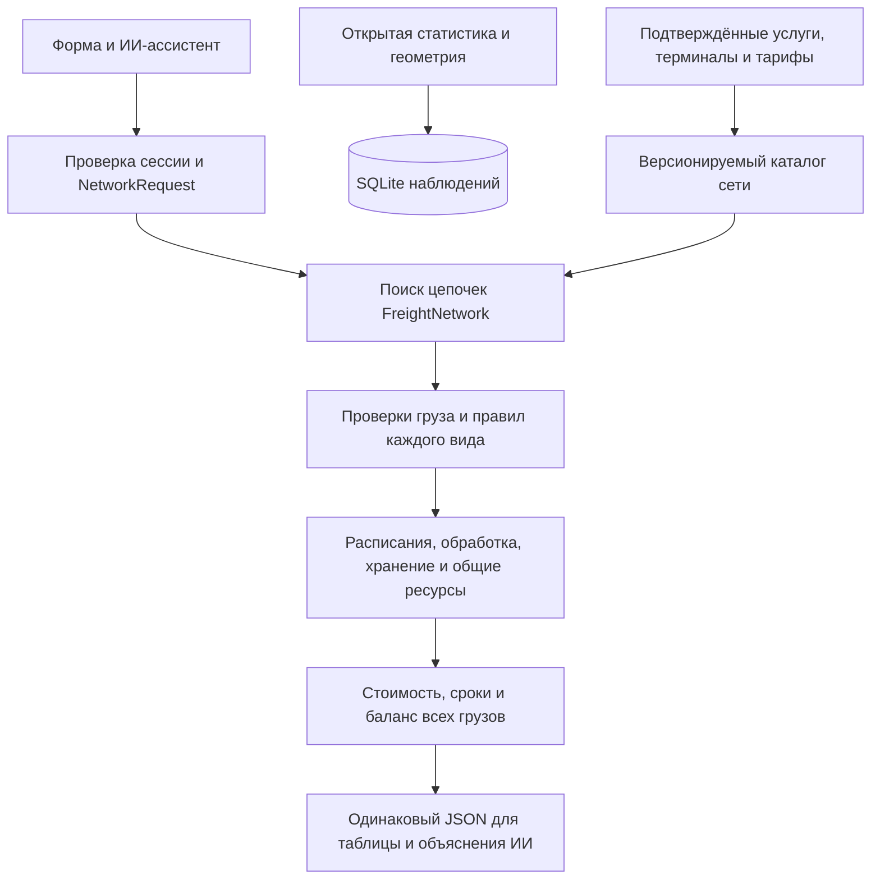

> **Низкоуровневое ядро, engine `network`.** Основной пользовательский API по населённым пунктам — [RUSSIA_NETWORK.md](RUSSIA_NETWORK.md). Этот документ объясняет симулятор, который используется общей сетью.

# Расчётное ядро сети — контракт 0.3

> Речной сценарий Красноярск ↔ Дудинка: опубликованные компонентные тарифы + явно заданные синтетические условия. Подключение и формулы — [RIVER.md](RIVER.md).

> Авиация ЧукотАВИА: опубликованные тарифы и плановые рейсы подключены отдельным методом и к общему `/calculations` с `engine: "chukotavia"`. Формулы и ограничения — [AVIATION.md](AVIATION.md). «Аэрогруз» не используется.

## Назначение и границы

Ядро сравнивает доставку одного и того же исходного набора грузов по связным цепочкам услуг. В нём шесть физических видов: автомобильный, железнодорожный, морской, речной, воздушный и трубопроводный. Седьмая категория — мультимодальная перевозка: цепочка с двумя и более различными видами. Отдельного физического ребра «мультимодальный» нет.

Можно задать `road → sea → air`, `road → rail → air → sea`, повторять виды на разных этапах, загружать и выгружать разные позиции по пути. Само наличие нужных видов в списке не доказывает существование маршрута: требуются конкретные услуги и переходы между ними.

**Каталог по умолчанию именно для engine `network` — синтетический пример из 6 хабов и 15 услуг.** Engine `russia` строит отдельную сеть из исходной связности и провайдеров; его покрытие и допущения описаны в основном контракте. Наблюдения о поездках не выданы за подтверждённые коммерческие грузовые связи. Полного подтверждённого покрытия России сейчас нет. Реестр всех 31 предоставленных источников и результаты проверки: [data_sources/AUDIT.md](data_sources/AUDIT.md).

Это сценарный расчёт, а не статистический прогноз спроса и не бронирование транспорта. Прогноз по историческому ряду должен быть отдельным модулем с проверкой на отложенных периодах. Региональные итоги нельзя подставлять вместо истории конкретного направления.

## Архитектура

| Модуль | Ответственность |
|---|---|
| `network/models.py` | Строгие модели груза, хаба, направленной услуги, перехода, тарифа и запроса. Неизвестные поля запрещены. |
| `network/graph.py` | Ссылочная целостность, поиск цепочек, явные маршруты, отпечаток каталога SHA-256. |
| `network/policies.py` | Приём груза, физические ограничения, совместимость, единицы цены, происхождение данных. |
| `network/resources.py` | Занятие парка, мест в отправлении, линий обработки и складов по времени. |
| `network/engine.py` | Общая временная симуляция кандидата, остатки консолидации, стоимость, сроки и выдача причин. |
| `network/observations.py` | Проверяемый импорт двух открытых CSV-наборов в отдельную SQLite. |
| `app/main.py` | Авторизация, ограничения запросов, API; расчёт не зависит от ИИ. |

Каталог сети загружается при старте из `NETWORK_CATALOG_PATH`; по умолчанию `backend/examples/network.json`. При изменении каталога сервер надо перезапустить. Опубликованная версия определяется `network_id` и `network_fingerprint`.

## Объекты данных

**Hub — конкретный объект**, а не город: склад, грузовой аэропорт, терминал станции, порт, трубопроводный терминал или подтверждённый комплекс. Два терминала одного города не соединяются автоматически. Межтерминальная доставка должна быть отдельной услугой с ценой и временем.

Хаб содержит виды транспорта, принимаемые типы груза и упаковки, гарантируемую температуру, окна работы, складские ограничения по тоннам/м³/часам, операции приёма и выдачи. Координаты необязательны для явной сети; для карты должны быть подтверждены.

**Service — направленная грузовая услуга** между двумя Hub. Обратное направление — отдельная запись. Нужны расписание, cutoff, время движения, вместимость, минимальная партия, цена, срок действия сведений и специфические ограничения вида. Дорога, железнодорожная линия или пассажирский рейс сами по себе Service не создают.

**Transfer — разрешённый переход** между входящей и исходящей услугами в хабе. Он задаёт допустимые грузы/упаковки, обработку и стоимость. Возможна специализация по `from_service_id` и `to_service_id`. Более конкретное правило имеет приоритет; два одинаково конкретных правила дают `insufficient_data`. Даже для двух услуг одного вида требуется явный переход: может понадобиться смена состава/оператора.

**Quote — один компонент цены**: `transport`, `handling` или `storage`. `all_in` распознаётся, но не суммируется с отдельно начисленными операциями: требуется разложение, иначе `insufficient_data`. В текущей версии все денежные величины — RUB; пересчёт валют не реализован. Минимальный и фиксированный сборы относятся к одной рассчитываемой партии/операции, не к каждой единице транспорта; иной тариф надо нормализовать отдельно.

**Evidence** содержит `source_ids`, `status`, дату наблюдения и период действия `[valid_from, valid_until)`. Статусы: `fact`, `market_reference`, `assumption`, `synthetic`, `unknown`. Несинтетический источник обязан иметь подходящую роль (`hub`, `freight_service`, `transfer`, `handling`, `cargo_properties`, `tariff`); ссылка на геометрию не подтверждает цену. Корректность первичного документа всё равно проверяет команда, а не одно имя роли в JSON.

## Правила разных видов

| Вид | Реализованные проверки | Какие данные требуется подтвердить |
|---|---|---|
| Авто | Масса и объём, полезная загрузка с учётом полной массы и тары, размеры и масса места при наличии ограничений, парк и время возврата, окна и сроки. | Грузовой маршрут и тариф, допустимая загрузка, доступный парк, время оборота. Осевые нагрузки/разрешения не рассчитываются из общей массы автоматически. |
| Ж/д | Те же проверки партии и вместимости; совпадение колеи услуги и обоих терминалов; расписание, cutoff, минимум партии, переходы. | Допуск груза/тары, конкретная грузовая услуга и терминальная обработка, колея, вагонная/контейнерная загрузка, расписание. |
| Море | Масса/объём, осадка против подтверждённого ограничения, навигационные окна, ледовый допуск, надводный габарит при заданном ограничении, портовая обработка. | Конкретная линия, судно/партия, терминалы, осадка для маршрута и причалов, ледовые требования, тариф/сборы. Годовая мощность порта не равна доступной мощности. |
| Река | Водные проверки, отдельная категория и отдельные услуги; сезонность задаётся датированными окнами. | Участок и судно, уровни/ограничения, мостовой габарит при необходимости, навигация, обработка и тариф. Погода не закрывает маршрут автоматически. |
| Авиа | Обязательный объём, масса/габариты отдельного места, грузовая вместимость рейса, cutoff, расписание, объёмный тарифицируемый вес. | Подтверждённый грузовой сервис, ограничение мест и объёма, тариф и коэффициент объёмного веса. Пассажирское сообщение этого не подтверждает. |
| Трубопровод | Один допустимый жидкий/газовый продукт, соответствующая наливная форма, пропускная способность, время закачки и транспортирования, занятость ресурса. | Подключение терминалов к конкретному трубопроводу, допуск продукта, доступная производительность и цена. Мука и грузы в мешках не допускаются. |
| Мультимодальная | Все проверки этапов плюс явный переход в каждом хабе, сквозной срок и стоимость, сохранение груза. | Подтверждение каждой услуги и каждого стыка, без автоматической переупаковки/смены состояния. |

Опасные грузы в этой версии не получают положительного заключения только по флажку: требуется отдельная модель допуска, документов и упаковки. При положительном флажке приёма результат всё равно `insufficient_data`; явный запрет даёт `infeasible`. Нельзя заявлять полную нормативную проверку перевозки.

## Временная модель и крайние случаи

1. Календарный модуль строит моменты готовности для разовой, регулярной или явно датированной перевозки. Конец регулярного периода исключён; месяцы календарные. Часовой пояс обязателен.
2. Каждая исходная позиция получает собственный экземпляр на каждую отправку; её срок начинается с готовности, а не с отправления транспорта. Дополнительная готовность в промежуточном хабе задаётся `ready_offset_hours`.
3. В одном посещении хаба последовательно выполняются выдача конечных позиций, переход транзитных и приём новых. Хранение учитывает всё время владения грузом, включая обработку и ожидание накопления/отправления.
4. Окна обработки должны вмещать операцию целиком. Отправление и прибытие обязаны попадать в окна соответствующих хабов; окно услуги покрывает перевозку целиком. Самолёт не «ждёт в воздухе» открытия терминала: ищется другой вылет.
5. `cutoff_hours` отсчитывается до отправления. Если обработка завершилась позже cutoff, ищется следующее отправление.
6. Для выделенного парка ресурс занят до прибытия плюс `turnaround_hours`. Для сборной услуги общие тонны/м³ учитываются на конкретное отправление. Для трубопровода занята производительность на время закачки; затем учитывается транспортная задержка.
7. Ресурсы общие для всех отправок внутри одного кандидата. Другой кандидат и другой HTTP-запрос — независимые сценарии. Это не живые остатки системы бронирования.
8. `group_sizes` задаёт проверяемые размеры групп исходных отправок. Последняя неполная группа сохраняется. Если она не проходит минимум услуги, кандидат не считается полностью доставленным. Более крупные группы могут оказаться невыгодны из-за ожидания и хранения.
9. Срок и срок годности проверяются для каждого экземпляра до завершения выдачи. Температурные требования пользователя и типа груза пересекаются; пользователь не может ослабить требование каталога.
10. Разные грузы требуют явной совместимости. Несовместимость даёт отказ; неизвестная совместимость — нехватку данных. Общий склад считается одной зоной, поэтому несовместимые пересекающиеся по времени партии также запрещены. Раздельные зоны в этой версии следует моделировать отдельными хабами/услугами.
11. Известная цена `0` допустима; отсутствующая цена — не ноль. Неизвестные данные не означают, что перевозки вообще не существует.
12. Результат `feasible` выдаётся только при совпадении массы всех исходных и доставленных позиций. Частичный расчёт не получает итоговую цену и рекомендацию.

## Поиск и ограничения реализации

Поддерживаются явная цепочка `service_ids`, точная последовательность `required_modes` и промежуточные `via_hub_ids` в указанном порядке. Автопоиск перебирает простые направленные пути без повторения хаба. Повторять вид транспорта в разных хабах разрешено.

Пределы: 64 исходные отправки, 20 позиций груза, 12 этапов, 32 пути, 4 варианта консолидации, 5000 раскрытий поиска, 4096 попыток поиска временного слота. При ограничении поиска это отражено в `search.truncated`. Рекомендация — лучшая среди рассчитанных кандидатов, а не доказанный глобальный оптимум. Последовательное планирование фиксировано; отказ кандидата не доказывает невозможность другой диспетчеризации.

Пока нет разветвления одной позиции по разным маршрутам, оптимизации укладки в несколько единиц для неделимых грузов, возвратных циклов, автоматической смены упаковки, стохастических задержек, онлайн-бронирования, контрактных минимумов сразу по нескольким направлениям, таможенной модели и расчёта выбросов. При отсутствии необходимой модели вывод должен оставаться ограниченным. Нельзя получать цену произвольного российского маршрута из синтетического примера.

Старый расчёт трёх схем остаётся доступен для совместимости с первым фронтом. Его контракт — [CALCULATIONS.md](CALCULATIONS.md), формулы — [FORMULAS.md](FORMULAS.md). Для нового экрана используйте [RUSSIA_NETWORK.md](RUSSIA_NETWORK.md). Контракт по ID хабов остаётся в [NETWORK_API.md](NETWORK_API.md).

## Свободные названия и справочные материалы

Название груза теперь вводится пользователем; каталог используется для необязательного распознавания по явным синонимам. Новый груз получает пользовательское описание только со статусом допущения, в пределах запроса; приём по профилю должен быть явно подтверждён в каждом хабе, услуге и переходе. Уточнения и миграция фронта: [CARGO_INPUT.md](CARGO_INPUT.md).

Справочники [Росморпорта](data_sources/rosmorport/README.md) и [стратегии](data_sources/strategy/README.md) импортируются в отдельный контекст. Они не смешаны с тестовыми тарифами и не создают автоматически действующие хабы/соединения. Стратегия поддерживает выбранную модель мультимодальных узлов и расписаний, но не доказывает её полную реализацию в России.

Единый расчёт по населённым пунктам, хабам и исходной связности РФ: [описание сети и API](RUSSIA_NETWORK.md). Новый engine `russia`, метод `/network/russia/calculations`; прежние методы сохранены.
